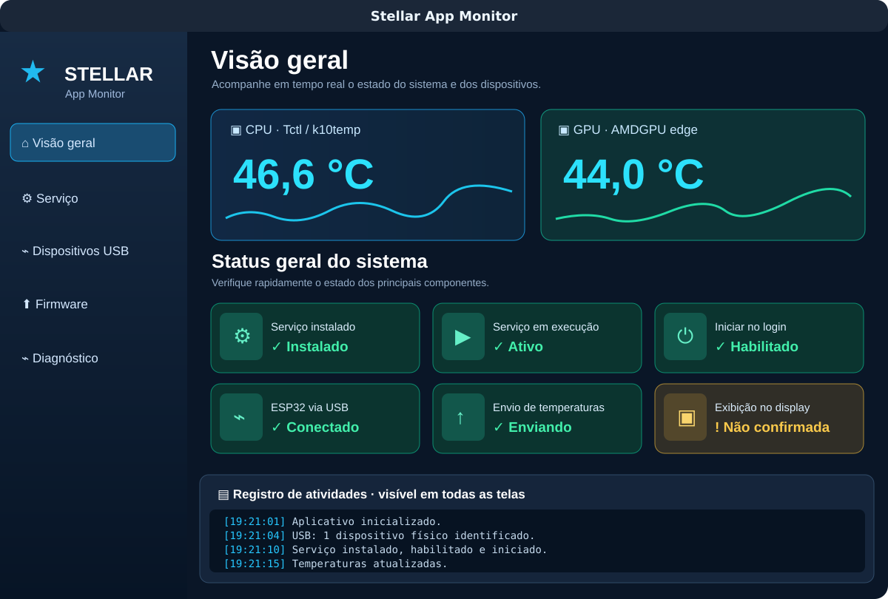

# Stellar App Monitor



> Prévia ilustrativa da interface. As temperaturas e os estados exibidos são exemplos; no aplicativo, os valores vêm do sistema.

Aplicativo gráfico para monitoramento de temperaturas da **AMD BC250** no **Bazzite** e **CachyOS**, com configuração de serviço `systemd --user`, seleção de ESP32-C3 e atualização do firmware do display **GC9A01**.

## Instalação em um comando

Abra um terminal na sessão gráfica do Linux e execute:

```bash
bash -c "$(curl -fsSL https://raw.githubusercontent.com/isaacalvex/AMD-BC250-Display-Status-Bazzite-CachyOS/main/install-app.sh)"
```

O instalador baixa o aplicativo, cria um ambiente Python isolado, instala as bibliotecas, cria um atalho em **Aplicativos** e tenta criar também na **Área de Trabalho**; em seguida abre o Stellar App Monitor. Não execute com `sudo`. É necessário ter Git, Python 3 com `venv`, conexão à Internet e sessão gráfica. Em alguns desktops será necessário escolher **Permitir execução** no atalho.

## Páginas do aplicativo

- **Visão geral:** CPU/GPU em tempo real, status de serviço, login, USB e envio de temperaturas.
- **Serviço:** instalar/remover, iniciar/parar/reiniciar e habilitar/desabilitar no login.
- **Dispositivos USB:** escolher porta e testar comunicação/permissões.
- **Firmware:** atualizar o ESP32-C3 com uma confirmação e indicador percentual, sem selecionar manualmente o arquivo.
- **Diagnóstico:** registros do serviço e testes dos sensores.
- **Atualizações:** clique **ATUALIZAR** para baixar a versão mais recente do GitHub com progresso percentual; depois **APLICAR ATUALIZAÇÃO** para instalar, atualizar dependências e reiniciar automaticamente o aplicativo.

Logs de cada operação ficam visíveis na parte inferior em todas as páginas. A tela inicial apresenta um cometa no logotipo e gráficos translúcidos de temperatura com histórico em tempo real atrás dos valores de CPU e GPU.

## Preparar monitoramento

1. Abra o app pelo menu de Aplicativos ou atalho da Área de Trabalho.
2. Na página **Serviço**, clique **Instalar/Atualizar**.
3. Conecte a placa ESP32-C3 com GC9A01, selecione a porta em **Dispositivos USB**, clique **Usar esta porta**.
4. Inicie o serviço e confira as temperaturas na **Visão geral**.
5. Em **Firmware**, clique **Atualizar firmware** quando precisar regravar. A primeira atualização prepara automaticamente o ambiente Arduino CLI e compila o firmware oficial no próprio computador, o que requer Internet e espaço em disco. As próximas atualizações reutilizam o binário somente enquanto o código .ino oficial não mudar; ao mudar, o firmware é recompilado automaticamente. **Não desconecte a placa durante a gravação.**

O firmware é destinado à pinagem do projeto original (MOSI 7, SCLK 6, CS 10, DC 2, BL 3). Placas ESP32-C3 com outra tela/pinagem podem precisar de firmware diferente. O aplicativo valida o tipo de chip via esptool.

### Problemas conhecidos

- USB não disponível: conecte a placa, escolha uma porta física válida; se houver erro de permissão, ajuste seu grupo de acesso e entre novamente na sessão.
- CPU/GPU indisponível: drivers e interfaces `hwmon` variam; verifique **Diagnóstico**.
- O envio de pacotes não confirma, sozinho, que a tela exibiu a imagem.

## Capturas de tela

Capturas reais dependem da execução no hardware e serão adicionadas após validação no CachyOS/Bazzite. O código e o fluxo de instalação foram preparados; os testes de gravação em diferentes placas ainda não foram concluídos.

### Erro ao baixar: DNS / Could not resolve host

Se o log mostrar `Could not resolve host: github.com`, é uma falha de **resolução de nomes da rede**, antes de qualquer instalação. O novo atualizador verifica o DNS antes de iniciar a transferência, registra o erro com mais clareza e não fica esperando indefinidamente. O aplicativo existente não é modificado quando a busca falha.

Na própria máquina Bazzite/CachyOS, confirme a resolução com `getent ahosts github.com` e depois teste o HTTPS com `curl -I --connect-timeout 8 --max-time 15 https://github.com`. Se a primeira consulta falhar, examine rede e DNS local com `resolvectl status` e reconecte sua rede, sem alterar permissões USB nem apagar arquivos. Se o acesso for normalizado, repita **ATUALIZAR → APLICAR ATUALIZAÇÃO**.

## Atualizar o aplicativo

Abra **Atualizações** no menu lateral. Clique em **ATUALIZAR** para consultar e baixar as alterações do repositório oficial. Depois clique em **APLICAR ATUALIZAÇÃO**. O app instala os novos arquivos, atualiza as bibliotecas Python do ambiente virtual e reinicia automaticamente. O progresso de transferência usa a porcentagem informada pelo Git; outras etapas aparecem em texto e nos logs, sem porcentagens artificiais. O recurso exige instalação pelo script oficial (que cria o clone Git) e rejeita atualizações com alterações locais ou histórico divergente.

### Corrigir porta USB no Bazzite (Fedora Atomic)

Ao instalar no **Bazzite**, o grupo `dialout` pode existir em `/usr/lib/group` e não em `/etc/group`. Nesse caso, simplesmente adicionar o usuário a `dialout` não resolve o acesso serial. O botão **Dispositivos USB → Corrigir permissões USB** agora:

1. Verifica se o ESP32 está conectado à porta e identifica o grupo real da porta.
2. Solicita sua confirmação e autenticação administrativa via Polkit.
3. Registra o grupo existente em `/usr/lib/group` no arquivo `/etc/group` **somente se estiver ausente**, com backup anterior.
4. Adiciona a conta da sessão ao grupo `dialout` ou `uucp`, conforme o dispositivo.
5. Registra o resultado no painel de logs e informa que é necessário **encerrar a sessão e entrar novamente** ou reiniciar.

Após reiniciar, verifique `id -nG` e teste **Dispositivos USB → Testar porta**. Se o grupo ainda não aparecer, não tente repetir a alteração indiscriminadamente: confira os logs e a configuração. Em sistemas sem Polkit, use a [documentação do Bazzite](https://docs.bazzite.gg/Advanced/add-user-to-group/) para o procedimento manual. **Nunca use `chmod 777` para conceder acesso ao dispositivo.**

### ESP32 detectado, mas gravação falha por permissão USB

Se o Bazzite ou CachyOS mostrar `Permission denied: '/dev/ttyACM0'`, isso indica que o firmware pode estar compilado, mas o usuário da sessão não tem acesso ao dispositivo. Em **Dispositivos USB → Corrigir permissões USB**, o aplicativo verifica dono, grupo e acesso de leitura/gravação antes de gravar. Para grupos `dialout` e `uucp`, ele pode solicitar autorização administrativa e incluir o usuário no grupo correto. **É necessário sair da sessão gráfica e entrar novamente** para ativar a nova associação de grupos. Não use `chmod 777` nas portas.

Para diagnosticar pelo terminal: `ls -l /dev/ttyACM0` e `id -nG`. Antes de preparar ou gravar firmware, o aplicativo verifica permissões e apresenta uma explicação, evitando compilar sem possibilidade de acessar a placa. Depois que as permissões forem corrigidas, o firmware já compilado é reutilizado.


## Downloads de jogos Steam no display STELLAR

**Compatibilidade:** a detecção deve funcionar tanto no **Modo Desktop** quanto no **Modo Gaming** do Bazzite, pois lê os arquivos locais da Steam. Não depende da interface visual em que a Steam está aberta.

**Diagnóstico em caso de download não detectado:** atualize o aplicativo, abra **Diagnóstico → Verificar downloads Steam** enquanto um jogo estiver realmente baixando. O painel agora lista os arquivos `appmanifest` candidatos com `StateFlags`, `BytesDownloaded` e `BytesToDownload`, além de eventos recentes de `content_log.txt`. A detecção usa esses eventos quando os campos do manifesto estão atrasados. Se mesmo assim não houver jogo, envie esses resultados para adaptar o leitor à versão instalada da Steam.


O monitor Python procura Steam instalada no Linux (Bazzite, CachyOS e Flatpak), inclusive bibliotecas em outros discos definidas no arquivo `libraryfolders.vdf`. Ele consulta os arquivos **Steam appmanifest_*.acf**, que contêm o nome do jogo e os contadores **BytesDownloaded / BytesToDownload**, e o arquivo **content_log.txt**, que pode registrar a velocidade global de download. Sem API oficial pública de atualização contínua, esses dados podem mudar apenas em intervalos — **a porcentagem pode demorar a atualizar**. O serviço não altera nenhum arquivo da Steam.

Quando o monitor encontra uma transferência ativa, envia pela mesma USB do ESP32-C3:

```text
CPU:46.6;GPU:44.0
DL:1;PCT:65;SPEED:28.4;NAME:Cyberpunk 2077
```

Se a velocidade não estiver disponível, envia `SPEED:-1` e o display mostra **-- MB/s**, em vez de inventar um valor. Quando a transferência termina ou é pausada, envia `DL:0` e volta às temperaturas. O nome fica **sempre em uma linha**, cortado com `...` sem alterar a posição da porcentagem, velocidade ou círculo.

Para ativar, atualize o app pelo menu **Atualizações → ATUALIZAR → APLICAR ATUALIZAÇÃO**. O serviço `bc250-display.service` é reiniciado automaticamente. Em seguida, vá à tela **Firmware → Atualizar firmware**; o app verifica o novo `.ino`, recompila somente se necessário e grava o ESP32. **Atualizar apenas o app sem regravar o firmware não cria a nova tela no display.**

### Verificação da Steam

Na página **Diagnóstico**, clique em **Verificar downloads Steam**. O app mostrará as bibliotecas encontradas e o download ativo, se houver. No terminal, o mesmo diagnóstico pode ser consultado com:

```bash
~/.local/share/stellar-app-monitor/.venv/bin/python ~/.local/share/stellar-app-monitor/stellar_monitor.py --steam-status
```

Se houver um jogo em download e o diagnóstico não o identificar, confira se a Steam está escrevendo `appmanifest_*.acf` e se a biblioteca aparece em `libraryfolders.vdf`. A detecção foi desenvolvida com arquivos locais da Steam, e o formato desses arquivos pode mudar em futuras versões do cliente. A leitura da velocidade vem de entradas recentes do log ou da variação do contador de bytes; **não é garantido que corresponda exatamente ao indicador da interface Steam em cada instante**.


### Se o download não aparecer no ESP32

Não é necessário regravar o firmware para testar alterações apenas no Python. Depois de **Atualizações → ATUALIZAR → APLICAR ATUALIZAÇÃO**, vá a **Diagnóstico** e use dois testes independentes:

1. **TESTAR TELA DE DOWNLOAD NO ESP32**: interrompe brevemente o serviço com sua confirmação, envia um exemplo de download por USB (65%, 28,4 MB/s, TESTE STELLAR), encerra o exemplo e restaura o serviço. **Nenhum firmware é gravado nesse teste.** Se a tela mudar, o display e o protocolo estão funcionando.
2. **Verificar downloads Steam**: com um jogo realmente baixando, lista bibliotecas, contadores dos manifests e eventos recentes de `content_log.txt`. O leitor foi ajustado para downloads longos e para manifests que só são salvos em checkpoints.

Se o teste visual funcionar, mas o diagnóstico mostrar **nenhum jogo**, o problema está na fonte de dados da Steam; copie o diagnóstico para análise, sem alterar arquivos ou permissões da Steam. Os números na Steam podem não estar disponíveis em tempo real por meio dos arquivos locais.
